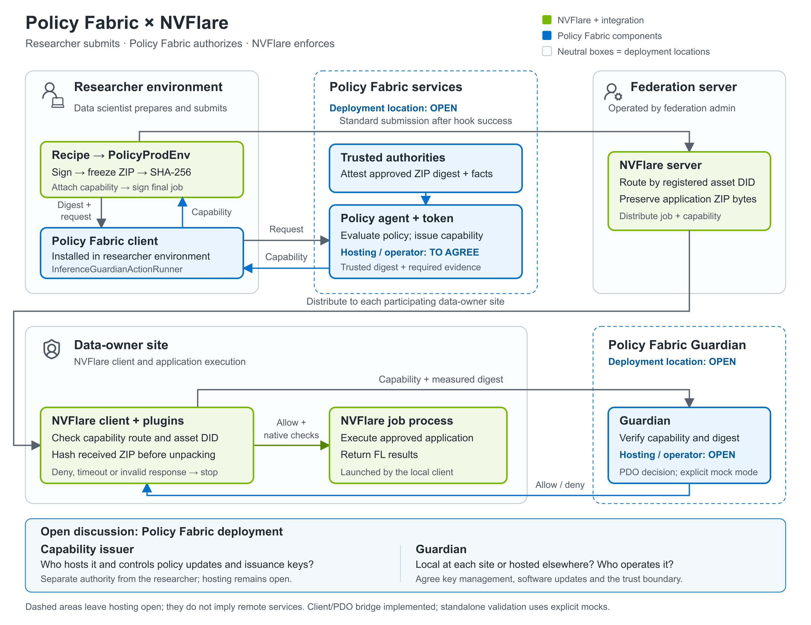
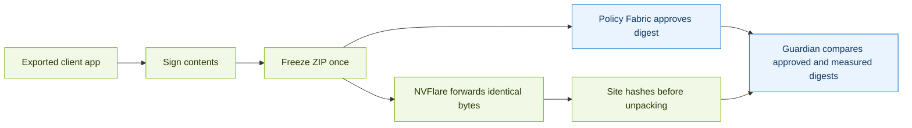

# Policy Fabric × NVFlare integration design

Updated **2026-11-09**. Integration branch based on MLCommons
[`authorities@31776f3`](https://github.com/mlcommons/policy_fabric/commit/31776f3df799047d001067271a1155e21bda1cc4),
which includes `inference-guardian` plus the new authority and request APIs.
NVFlare compatibility baseline: **2.9.0**.

## Overview

**Policy Fabric approves an application; each NVFlare site checks that it received
that application before running it.**

1. The researcher exports a normal Recipe. The integration signs and freezes
   each client application as a ZIP and computes its SHA-256 digest.
2. The installed Policy Fabric client asks the data asset's policy for a
   capability. Policy Fabric checks the supplied evidence, including a trusted
   credential approving that exact ZIP digest, and issues the capability.
3. NVFlare distributes the frozen application and capability. Each site measures
   the received ZIP and asks its configured Guardian to verify the capability
   against that measurement. Only an explicit matching allow, followed by native
   NVFlare checks, permits deployment and execution.

**The Guardian verifies authorization; NVFlare controls execution.** Dataset
contents stay with the FL application. The inference Guardian returns a decision,
not dataset bytes, and does not run the application.

The client connection and real Guardian wire contract are implemented. The
self-contained demo still selects **mock issuance and mock Guardians**. Full
PDO-backed trust has not yet been validated with NVFlare; see [validation](VALIDATION.md).

## Team overview



[Editable SVG](assets/nvflare-policyfabric-overview.svg) ·
[High-resolution PNG](assets/nvflare-policyfabric-overview.png)

**The researcher submits; Policy Fabric authorizes; NVFlare enforces.** NVIDIA
green (`#76B900`) identifies NVFlare and its integration plugins. Blue
(`#0072CE`) identifies Policy Fabric. Neutral boxes show deployment locations,
not administrative isolation or cryptographic trust boundaries.

The researcher installs the **Policy Fabric client** alongside the submission
code. `PolicyFabricCapabilityProvider` resolves each data asset and invokes the
existing inference runner. The client requests authorization; it does not become
the authority that approves its own application. Trusted authorities supply the
credentials accepted by the selected asset policy.

The issuer and Guardian appear in **separate dashed areas** because their hosting,
operators, key management and software administration remain open. The Guardian's
position outside the data-owner box does not select remote hosting. The current
adapter requires loopback HTTP, while the standalone test runs all components
under one OS user. Neither establishes independent administrative control.

Discussion points:

- Who operates the policy agent/token services and the credential authorities?
  Who may change policies, approve application digests and control keys?
- Who operates each Guardian? Is it local to the site or hosted elsewhere?
  A remote option needs authenticated transport and a revised endpoint contract.
- How will the trusted association between an NVFlare site and its data asset
  be established? Registration carries a routing claim, not proof of ownership.

## Components already available

| Responsibility | Policy Fabric component | NVFlare component / integration |
| --- | --- | --- |
| Discover the data asset and its policy token | `registry_client.get_asset_by_did()`; asset `metadata.policy_contract` | Site advertises `client.site_config.asset_did`; router reads `Client.get_site_config()`. |
| Check required evidence and request authorization | `InferenceGuardianActionRunner`; `readiness`; `pdo_runner.create_capability(request=...)` | `PolicyFabricCapabilityProvider` supplies the exact archive digest and selected role wallets. |
| Approve the artifact digest | Trusted `ScriptHashCredential`; inference delivery policy compares `scriptHash` with `request.script_digest` | `PolicyJobPreparation` signs/freezes once; `job_hash.py` measures bytes. |
| Evaluate policy and issue capability | `rego_policy_agent` and `rego_token` via PDO | Capability transported in job metadata; no policy evaluation in NVFlare. |
| Validate capability and measured digest | PDO Guardian framework and `InferenceOperation` (`do_inference`) | `GuardianClient(mode="pdo")` sends capability + local measurement. |
| Enforce before execution | Explicit allow response | `PolicySecurityHandler` for early metadata denial; `PolicyAppDeployer` for the byte check; normal native checks follow. |

The framework-specific glue is in this example, not NVFlare core. Policy Fabric's
webapp modules are reused directly; they are not yet a separately packaged,
stable client SDK. The new upstream inference decision operation is used unchanged.
The older [Guardian issue](GUARDIAN_ISSUE_DRAFT.md) is retained as historical context;
the decision-only operation it discussed is now present in this branch.

## Recipe submission and approval timing

`PolicyProdEnv` is an example-local `ProdEnv` subclass. Its generic
`before_submit(job_dir)` callback runs after the finalized Recipe is exported,
before standard Flare API submission. The callback signs, freezes, requests
capabilities and signs the final job. The returned `Run` still provides normal
status, abort and results. A preparation failure prevents submission.

```python
provider = PolicyFabricCapabilityProvider.from_file("policy-client.json")
env = PolicyProdEnv(
    startup_kit_location=admin_kit,
    username="admin@example.org",
    before_submit=PolicyJobPreparation(admin_kit, capability_provider=provider),
)
run = recipe.execute(env)
```

The new delivery rule accepts **only a digest covered by a trusted Script
credential**. It is not permission for a requester to authorize arbitrary bytes
by naming their hash. The `Script` role identifies the approved ZIP, including
configuration and signing artifacts. A credential for `client.py` alone is not
a credential for that ZIP.

If approval requires an external review, use the supported two-stage path:
`recipe.export(...)` → `preparation.freeze(job_dir)` → trusted authority approval
→ `preparation.authorize(job_dir)` → normal `Session.submit_job(job_dir)`.
The existing frozen ZIPs survive the wait unchanged. Calling `recipe.execute()`
after approval would create another export and may invalidate the digest.
The [README](README.md#approve-the-exact-archive-before-submitting) gives commands.
The one-call hook is suitable when the client/issuer can satisfy approval during
that call. This integration does not automatically issue trusted digest credentials.

The [upstream hook proposal](NVFLARE_HOOK_PROPOSAL.md) remains a potential
NVFlare core contribution. `before_submit` is **not stock `ProdEnv` functionality**;
the compatibility subclass uses private NVFlare 2.9 session-manager wiring.
Policy-specific logic would stay outside a generic core hook.

## Registration and capability routing

Each site configures a data **asset DID** independently of its NVFlare site name:

```json
{"client": {"site_config": {"asset_did": "did:pdo:site-a-data-asset"}}}
```

NVFlare's normal authenticated client registration transports `site_config`.
The server's `PolicyRegistrationRouter` listens for
`BEFORE_CHECK_CLIENT_RESOURCES`, reads `Client.get_site_config()`, and rebuilds
routes from the current registration snapshot. Submitted routes are discarded.

```text
site_a → registered data asset DID → capability for app_site_a
site_b → registered data asset DID → capability for app_site_b
```

The provider resolves asset metadata to the **token contract**, and the token
resolves its trusted **policy agent**. Those identifiers are distinct; no
conversion from the site name or conflation with a policy ID is needed.

Metadata stores the bundle at
`custom_props.policy_fabric_capabilities[asset_did][app_name]`. The site checks
its routed asset DID against local configuration. One data asset/Guardian per
site and a flat deployment map (including `@ALL`) are the current assumptions.
The whole bundle travels in shared metadata: routing does not provide per-site
confidentiality. PDO binds a genuine capability to its Guardian; this path still
needs integration validation. NVFlare registration alone does not establish
asset ownership.

## Two enforcement gates

**Early job authorization:** `PolicySecurityHandler` handles
`AUTHORIZE_COMMAND_CHECK` for `check_resources` and `submit_job`. It rejects
missing capabilities and inconsistent asset routes. This hook sees metadata,
not application bytes. It only records denials and cannot overwrite another
handler's denial with an allow.

**Before application deployment:** `PolicyAppDeployer` receives the actual
application bytes, validates the route's app name, computes the digest and calls
the Guardian. A mismatch, denial, invalid reply or service failure stops
deployment before unpacking. A matching allow delegates to the standard
`AppDeployer`, preserving native signatures, scope and application checks.

The Guardian relies on the trusted site daemon/plugin to measure the correct
bytes and honor its reply. This is not remote attestation. The client plugin
and Guardian endpoint configuration must be installed under site control,
never loaded from a submitted job.

## Exact-byte hashing and preservation

**Hash the complete frozen client application ZIP that the site will deploy.**
Code, configuration, packaged assets and included signatures/certificates all
participate. `job_hash.py` accepts bytes or a file and returns `sha256:<hex>`.
It has no NVFlare/PDO dependency, canonicalization, adapter mapping or manifest.



NVFlare normally unpacks and repacks submitted apps, which can change ZIP bytes.
`FrozenAppJobManager.get_app()` extracts the inner `policy_payload.zip` unchanged
for delivery. Adjacent exported files support native submission checks; the
frozen archive is authoritative for client execution. Capabilities live outside
the measured ZIP, avoiding a circular hash. The final outer job is signed after
capabilities are attached.

The digest does **not** bind the outer deployment map or other metadata, server
application, dataset contents, installed dependencies, environment, dynamic
downloads, later model/task messages, or post-deployment modification. Those
require separate native/runtime controls or additional policy requirements.

## Guardian and researcher-client contracts

The provider calls the existing inference runner with:

```python
params={"script_digest": measured_zip_digest, "project": optional_project}
wallets={"Script": archive_identity, "User": requester_wallet_if_required}
```

The runner resolves readiness and requests a policy decision before token
issuance. Config cannot override the measured digest. The provider returns
`{asset_did: {app_name: base64_encoded_capability_envelope}}`. It does not decrypt
the operation, invent evidence, fetch a Python script, or use Policy Fabric's
toy FL server. NVFlare supplies and distributes its own application artifact.

In `pdo` mode (the default), the site unwraps only the base64 transport encoding
and sends the capability's original top-level fields plus:

```json
{"request_context": {"calculated_script_digest": "sha256:<received ZIP digest>"}}
```

The request is `POST /process_capability` to a site-configured loopback HTTP
origin. PDO authenticates/decrypts the capability before dispatching to
`InferenceOperation`. That operation compares its authorized `script_digest`
with the measured digest and returns:

```json
{"allowed": true, "script_digest": "sha256:<same digest>", "method_name": "do_inference"}
```

A mismatch produces the framework's HTTP 422; capability validation can fail
before reaching the operation. The client requires HTTP 200 and all three
matching fields, and rejects any mock marker in PDO mode. `do_inference` is the
upstream operation name even when the approved NVFlare app performs training;
the Guardian itself does not execute training or inspect workflow semantics.

Explicit `mock` mode instead sends `{capability_b64, request_context}` and
requires `mock: true` in the reply. There is no automatic downgrade. The upstream
mock is unchanged. Both modes reject redirects, timeouts and oversized or
malformed replies. Real crypto trust comes from PDO and the configured endpoint,
not from the shape of an allow response.

The upstream Guardian launcher includes a toy FL client. Deploying its Guardian
core for NVFlare requires appropriate process/container networking; that toy
client is not an NVFlare integration. The current endpoint restriction means the
Guardian must be reachable in the NVFlare daemon's loopback network namespace.
Remote hosting and authenticated transport remain future integration work.

## Implementation map and validation boundary

| File | Purpose |
| --- | --- |
| [submission_hook.py](submission_hook.py) | Generic local `PolicyProdEnv` submission hook. |
| [prepare_job.py](prepare_job.py) | Sign/freeze, authorize and attach capabilities; one-step or delayed approval. |
| [policy_client.py](policy_client.py) | Researcher-side registry/inference-runner bridge. |
| [pf_nvflare.py](pf_nvflare.py) | Server routing/preservation and client authorization/deployment/Guardian plugins. |
| [job_hash.py](job_hash.py) | Framework-independent byte/file hashing. |
| [demo.py](demo.py) | Secure two-site NVFlare demonstration with explicit mocks. |

The [recorded validation](VALIDATION.md) distinguishes full NVFlare execution
from stubbed PDO contract tests. Remaining validation is a complete live
credential → policy → encrypted capability → real Guardian → NVFlare execution
flow, including invalid issuer/audience and policy-denial cases. Lifetime,
revocation and replay behavior must be checked against the actual PDO contracts
rather than inferred from this adapter. Dataset access, runtime isolation and
post-deployment integrity are separate enforcement concerns.

The original PoC and its local design work were checkpointed on
`feat/nvflare-policyfactory-poc` at `e7cb922` before migration. This branch starts
from the new repository's history and carries only the integration example and
its documentation forward. The earlier validation and issue draft remain as
explicitly labeled historical records.
